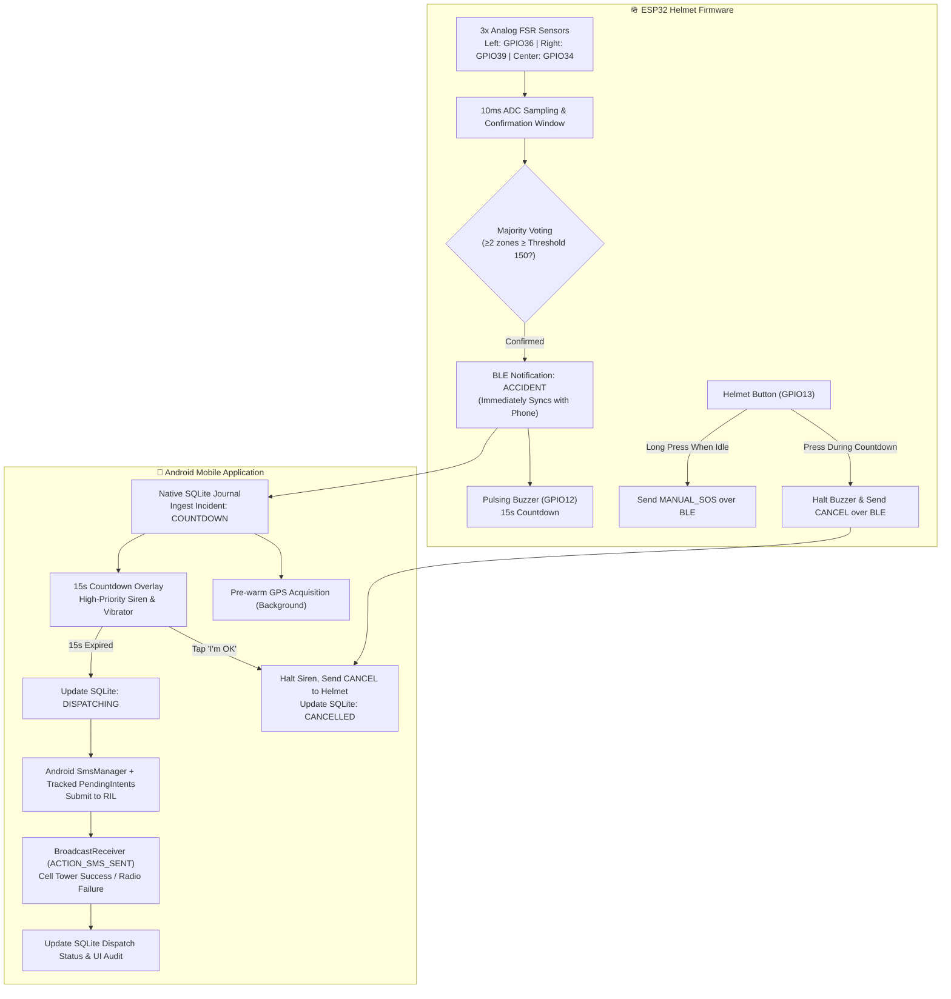

# SafeHelm 🪖⚡

[](firmware/)
[](mobile/)
[](mobile/android/)
[](protocol/BLE_PROTOCOL.md)
[](LICENSE)

> **Integrated IoT Helmet Accident Detection & Autonomous Emergency Telematics System.**

SafeHelm connects embedded physical impact sensing with Android emergency telematics over Bluetooth Low Energy (BLE). When severe impact is detected across distributed helmet zones or when the manual SOS button is pressed, the system coordinates a synchronized 15-second cancellation window across both the helmet hardware and smartphone. If not cancelled, the system autonomously acquires the best available GPS coordinates and dispatches SMS alerts to the rider's designated emergency contacts, tracking exact cell-tower delivery callbacks through a local transactional SQLite journal.

---

## 📑 Table of Contents

- [System Architecture](#-system-architecture)
- [Hardware Wiring & Pinout](#-hardware-wiring--pinout)
- [Synchronized Emergency Workflow](#-synchronized-emergency-workflow)
- [Native SQLite Journal & SMS Tracking](#-native-sqlite-journal--sms-tracking)
- [Firmware Setup & Flashing](#-firmware-setup--flashing)
- [Android Setup & Permissions](#-android-setup--permissions)
- [Build & Test Verification](#-build--test-verification)
- [Known Limitations & Safety Disclaimer](#-known-limitations--safety-disclaimer)

---

## 🏛️ System Architecture



---

## 🔌 Hardware Wiring & Pinout

SafeHelm uses an **ESP32 DevKit (38-pin)** with three analog Force Sensitive Resistors (FSR402), an active buzzer driver, and a momentary tactile push button.

| Component | ESP32 GPIO | Electrical Circuit Topology | Function |
|---|---|---|---|
| **Left FSR** | `GPIO 36` (`VP`) | `3.3V` → FSR → `GPIO 36` → `1kΩ Pulldown` → `GND` | Left temporal impact zone |
| **Right FSR** | `GPIO 39` (`VN`) | `3.3V` → FSR → `GPIO 39` → `1kΩ Pulldown` → `GND` | Right temporal impact zone |
| **Center FSR** | `GPIO 34` (`D34`) | `3.3V` → FSR → `GPIO 34` → `1kΩ Pulldown` → `GND` | Crown / forehead impact zone |
| **Active Buzzer** | `GPIO 12` | `GPIO 12` → `1kΩ Base Resistor` → `2N2222A Base` <br> `Collector` → Buzzer `-` terminal <br> `Emitter` → `GND` <br> Buzzer `+` terminal → `5V VIN` <br> `1N4007 Diode` across buzzer terminals (Cathode to `+5V`, Anode to Collector) | Pre-dispatch audio alarm (flyback diode protects transistor from reverse EMF) |
| **Control Button** | `GPIO 13` | Button pin 1 → `GPIO 13` <br> Button pin 2 → `GND` <br> Uses internal `INPUT_PULLUP` (`HIGH` released, `LOW` pressed) | Hardware countdown abort & manual SOS trigger |

---

## ⏱️ Synchronized Emergency Workflow

### 1. Detection & Concurrent Countdown (15 Seconds)
- When at least **2 out of 3 FSR sensors** exceed the crash threshold (default: `150`) within a 50ms confirmation window, the firmware enters `CRASH_CONFIRMED`.
- The firmware immediately transmits an `"ACCIDENT"` BLE notification to the smartphone and starts pulsing the helmet buzzer (GPIO 12).
- The smartphone immediately ingests the incident into its **Native SQLite Journal**, triggers a high-priority audio siren and vibration, and displays a full-screen 15-second countdown gauge.
- Simultaneously, the smartphone **pre-warms the GPS receiver** in the background so that coordinates are ready the moment the timer hits zero.

### 2. Bidirectional Cancellation
- **From the Helmet**: Pressing the helmet button during the 15-second window immediately silences the helmet buzzer, resets firmware state to `MONITORING`, and transmits a `"CANCEL"` event over BLE to cancel the smartphone countdown and siren.
- **From the Phone**: Tapping **"I'M OK — CANCEL ALERT"** on the smartphone screen immediately stops the siren, writes `"CANCEL"` to the helmet's BLE characteristic (halting the helmet buzzer), and marks the incident `CANCELLED` in the SQLite journal and audit history.

### 3. Location Acquisition & Autonomous Dispatch
- If the 15-second countdown expires without cancellation:
  - Phone acquires the best available location fix: **Tier 1**: High-precision fresh GPS fix (up to 12s budget) → **Tier 2**: Hardware-cached last-known location → **Tier 3**: Network/cell tower approximate fix.
  - Location coordinates, accuracy (in meters), timestamp, and provenance source are saved to the SQLite incident record.
  - Emergency SMS messages are formatted with the rider's name, blood group, medical notes, coordinates, and Google Maps link (`https://maps.google.com/?q=lat,lng`).
  - Messages are sent exclusively to the user's explicitly configured, enabled emergency contacts.

---

## 💾 Native SQLite Journal & SMS Tracking

SafeHelm avoids naive assumptions that calling an SMS API means a message was delivered.

### Finite State Machine (`IncidentState`)
```
DETECTED ➔ COUNTDOWN ➔ LOCATION_ACQUIRED ➔ DISPATCHING ➔ DISPATCHED
    │            │                                  │
    │            └── CANCELLED                      ├── PARTIAL_FAILURE
    │                                               ├── FAILED
    └── QUEUED_OFFLINE                              └── QUEUED_OFFLINE
```

### Telephony Sent-Result Tracking
1. When SMS dispatch begins, each contact message is divided via `SmsManager.divideMessage(body)`.
2. A unique `dispatchId` (`<incidentId>_<phone>`) and dispatch draft record are persisted to SQLite **before** submitting to telephony.
3. Tracked `PendingIntent`s are attached to each message part with `ACTION_SMS_SENT`.
4. A registered `BroadcastReceiver` receives the actual radio callback from Android Telephony:
   - `Activity.RESULT_OK`: Marked `SENT_RADIO_CONFIRMED` in SQLite and live event stream.
   - `SmsManager.RESULT_ERROR_NO_SERVICE`: Marked `RADIO_NO_SERVICE`.
   - `SmsManager.RESULT_ERROR_RADIO_OFF`: Marked `RADIO_RADIO_OFF` (airplane mode).
   - `SmsManager.RESULT_ERROR_GENERIC_FAILURE`: Marked `RADIO_GENERIC_FAILURE`.
5. Riders can tap any incident in the **History** tab to inspect recipient-by-recipient status, confirmed parts, and radio result codes.

---

## 🛠️ Firmware Setup & Flashing

### Prerequisites
- [PlatformIO Core](https://platformio.org/) or PlatformIO VS Code Extension.
- Micro-USB cable connected to the ESP32.

### Commands
```bash
# Navigate to firmware directory
cd firmware

# Compile firmware
pio run

# Flash to connected ESP32
pio run --target upload

# Open serial monitor at 115200 baud
pio device monitor -b 115200
```

---

## 📱 Android Setup & Permissions

### Prerequisites
- **Flutter SDK**: 3.20+ (stable channel).
- **JDK**: Java 17 or Java 21 (Gradle 8.11 / AGP compatible).
- **Android Target**: SDK 35 (Android 15), minimum SDK 26 (Android 8.0).

### Required Android Runtime Permissions
SafeHelm requests the following permissions for emergency operation:
- `android.permission.SEND_SMS`: Required to dispatch emergency text messages directly without manual user confirmation in a crash.
- `android.permission.ACCESS_FINE_LOCATION` & `ACCESS_COARSE_LOCATION`: Required to capture GPS coordinates for emergency responders.
- `android.permission.BLUETOOTH_SCAN` & `BLUETOOTH_CONNECT`: Required on Android 12+ (SDK 31+) to pair with the ESP32 helmet over BLE.
- `android.permission.POST_NOTIFICATIONS`: Required for foreground service telematics monitoring.
- `android.permission.VIBRATE`: Required for high-priority haptic alarm during countdown.

---

## 🧪 Build & Test Verification

All automated tests have been executed and verified in the environment:

### 1. Flutter Unit & State Machine Tests
Tests protocol parsing, contact validation, storage persistence, and `EmergencyController` countdown/cancellation/journal integration:
```bash
cd mobile
flutter test
```
*Result: 16 of 16 tests passing.*

### 2. Android Native SQLite Journal Unit Tests
Tests schema creation, WAL mode, foreign keys, transaction rollbacks, state transitions, duplicate incident rejection, and corruption recovery on the JVM:
```bash
cd mobile/android
.\gradlew :app:testDebugUnitTest
```
*Result: 10 of 10 tests passing (0.89s).*

### 3. Firmware Build
Validates ESP32 FreeRTOS compilation, NimBLE GATT server, 10ms ADC sampling, and JSON serialization:
```bash
cd firmware
pio run
```
*Result: Flash 46.7%, RAM 11.0%, 0 errors.*

### 4. Build Debug Android Package (APK)
```bash
cd mobile
flutter build apk --debug
```
*Result: `app-debug.apk` built successfully.*

---

## ⚠️ Known Limitations & Safety Disclaimer

1. **Academic & Research Prototype**: SafeHelm is an experimental engineering research system. It is **not** a substitute for certified protective headgear meeting DOT (FMVSS 218), ECE 22.06, or SNELL M2020 standards.
2. **Sensor Scope**: The current hardware configuration utilizes three Force Sensitive Resistors (FSRs) to detect direct external compressive force across the helmet shell. It does **not** detect rotational brain acceleration or high-g freefall without an IMU (accelerometer/gyroscope).
3. **SMS & Carrier Dependency**: Autonomous SMS dispatch requires an active carrier SIM card, sufficient cellular reception, and granted Android runtime permissions. SafeHelm reports `RADIO_NO_SERVICE` if cellular towers are unreachable.
4. **Emergency Contact Configuration**: SafeHelm alerts are sent **exclusively to the rider's explicitly configured emergency contacts**. SafeHelm does **not** automatically dial 911, 112, or public emergency response services.
5. **No Destructive Crash Testing**: Do not strike or crush safety-certified riding helmets for testing. Use the built-in app simulation mode or apply controlled fingertip pressure to test FSR threshold triggers.

---

## 📄 License & Author

Developed by **[Saifuddin (Saif)](https://github.com/SAIFew)**.
Licensed under the **MIT License** — see [LICENSE](LICENSE) for details.
