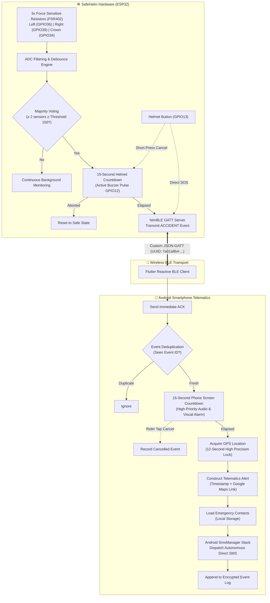

# SafeHelm 🪖⚡

[](LICENSE)
[](firmware/)
[](mobile/)
[](mobile/android/)
[](protocol/BLE_PROTOCOL.md)
[]()

> **An intelligent, dual-stage accident detection & emergency telematics ecosystem for two-wheeler safety.**

SafeHelm bridges embedded real-time impact sensing with modern mobile emergency telematics. By pairing an ESP32 multi-sensor helmet array with a high-performance Flutter Android application over an authenticated-by-protocol Bluetooth Low Energy (BLE) channel, SafeHelm detects severe crashes, minimizes false alarms through a two-tier cancellation window, captures real-time GPS coordinates, and autonomously dispatches emergency SMS alerts to designated family and emergency contacts during the critical "Golden Hour."

---

## 📑 Table of Contents

- [Overview & Problem Statement](#-overview--problem-statement)
- [Key Features](#-key-features)
- [System Architecture](#-system-architecture)
- [Hardware Specification & Bill of Materials](#-hardware-specification--bill-of-materials)
- [Dual-Stage False-Alarm Mitigation](#-dual-stage-false-alarm-mitigation)
- [Bluetooth Low Energy (BLE) Wire Protocol](#-bluetooth-low-energy-ble-wire-protocol)
- [Mobile Companion App](#-mobile-companion-app)
- [Repository Structure](#-repository-structure)
- [Getting Started](#-getting-started)
  - [1. Firmware Setup (ESP32)](#1-firmware-setup-esp32)
  - [2. Mobile App Setup (Flutter / Android)](#2-mobile-app-setup-flutter--android)
  - [3. Sensor Calibration](#3-sensor-calibration)
- [Testing & Validation](#-testing--validation)
- [Roadmap](#-roadmap)
- [Safety & Legal Disclaimer](#-safety--legal-disclaimer)
- [License & Author](#-license--author)

---

## 🎯 Overview & Problem Statement

Motorcycle and two-wheeler riders face disproportionately high risks on roadways. When a serious collision occurs, victims are frequently incapacitated, rendering them unable to call for emergency medical assistance. Survival rates drop dramatically when medical treatment is delayed past the **"Golden Hour"** (the first 60 minutes post-trauma).

### Why Existing Solutions Fall Short:
1. **Expensive Onboard Cellular Subscriptions**: Dedicated cellular modules (GSM/LTE/eSIM) installed inside helmets consume significant battery power and require riders to pay recurring monthly SIM card data subscriptions.
2. **High False Positive Rates**: Primitive systems that rely on a single sensor or basic tilt switch trigger false alarms when a rider drops their helmet, taps it on a shelf, or hits a rough speed bump. Emergency contacts quickly experience alarm fatigue and disable alerts.
3. **Flaky Bluetooth Stacks**: Naive BLE integrations drop packets or crash when backgrounded, failing when an actual emergency happens.

### The SafeHelm Philosophy:
- **Zero Ongoing Subscription Cost**: Leverages the rider's existing smartphone hardware (GPS & cellular stack) via low-power BLE GATT communication.
- **Majority-Voting Sensor Matrix**: Multi-zone Force Sensitive Resistor (FSR) threshold filtering requires simultaneous distributed force peaks across helmet zones to prevent accidental trigger on minor drops.
- **Fail-Safe Dual Cancellation Windows**: A 15-second on-helmet hardware audio countdown followed by a 15-second smartphone visual/audible countdown ensures conscious riders can dismiss accidental bumps before any SMS alert is dispatched.
- **Deterministic Offline-First Dispatch**: Native Android `SmsManager` integration ensures reliable SMS dispatch even when cellular data (4G/5G) is spotty or internet APIs are unreachable.

---

## ✨ Key Features

- **Multi-Zone Impact Triangulation**: 3 analog FSR sensors (Left Temporal, Right Temporal, Crown) sampled at high frequency with running-average software noise debouncing.
- **Dual-Stage Cancellation Pipeline**:
  - *Helmet Hardware Tier*: 15s pulsing buzzer with physical hardware abort button.
  - *Smartphone Telematics Tier*: 15s high-priority modal with sound and one-tap abort.
- **Bidirectional BLE Protocol (v1)**:
  - Custom compact JSON packets (< 180 bytes) optimized for single-packet GATT transmission.
  - Automatic 3-stage retransmission for unacknowledged emergency frames.
  - Idempotent deduplication engine ensuring repeated packets are handled exactly once.
- **Autonomous Emergency Telematics**:
  - High-accuracy GPS lock acquired within a 12-second budget.
  - Concise emergency SMS generation including exact coordinates, timestamp, and a direct Google Maps navigation URL (`https://maps.google.com/?q=lat,lng`).
- **Emergency Contact Book**: Local encrypted persistence supporting up to 5 prioritized emergency contacts with E.164 phone number formatting and validation.
- **Physical SOS Trigger**: Rider can initiate an instantaneous emergency broadcast at any time via a quick press of the helmet tactile button or via the app.
- **Hardware-in-the-Loop Simulation Mode**: Built-in mock telemetry generator allowing safe verification and demonstrations without triggering physical crash sensors.

---

## 🏛️ System Architecture



---

## 🔌 Hardware Specification & Bill of Materials

| Component | Part / Spec | Function | Connection / GPIO |
|---|---|---|---|
| **Microcontroller** | ESP32-WROOM-32 (38-pin DevKit) | Core processing, ADC sampling, BLE server | Main MCU |
| **Impact Sensor 1** | FSR402 (Force Sensitive Resistor) | Left-side impact detection | GPIO 36 (`VP`) via 1kΩ divider |
| **Impact Sensor 2** | FSR402 (Force Sensitive Resistor) | Right-side impact detection | GPIO 39 (`VN`) via 1kΩ divider |
| **Impact Sensor 3** | FSR402 (Force Sensitive Resistor) | Crown / Top impact detection | GPIO 34 (`D34`) via 1kΩ divider |
| **Audio Alert** | TMB12A05 5V Active Buzzer | Pre-dispatch audible warning alarm | GPIO 12 via 2N2222A Transistor |
| **Switching Transistor**| 2N2222A NPN BJT | Isolates ESP32 GPIO from 5V buzzer current | Base to GPIO 12 via 1kΩ |
| **Flyback Diode** | 1N4007 Rectifier Diode | Clamps inductive voltage spikes from buzzer | Parallel across buzzer terminals |
| **Control Button** | 12mm Momentary Tactile Switch | Abort countdown / Manual SOS trigger | GPIO 13 (Internal `INPUT_PULLUP`) |
| **Power Source** | 5V USB / Regulated 3.7V 18650 Li-Ion | System power supply | `VIN` & `GND` |

### Circuit Schematic Notes:
- **FSR Voltage Divider Topology**: Each FSR is wired as `3.3V` → `FSR` → `ADC Pin` → `1kΩ Pulldown` → `GND`. When idle (no force), the reading hovers near `0`. Under firm pressure, readings reach `225–240` (8-bit scaled).
- **Inductive Load Protection**: Active buzzers generate inductive transient spikes when switched off. The **1N4007 diode** is wired across buzzer terminals (Cathode/band to `+5V`, Anode to collector/negative) to protect the 2N2222A transistor and MCU from reverse EMF damage.
- **Button Debouncing**: Handled via hardware pull-up (`GPIO13` is `HIGH` released, `LOW` pressed) and firmware-level state validation.

---

## ⏱️ Dual-Stage False-Alarm Mitigation

False alarms destroy trust in emergency alert systems. SafeHelm implements a **two-tier fail-safe window** offering a total of 30 seconds to cancel false triggers:

```
[Crash Detected] 
       │
       ▼
[0s ──────── 15s] ── Stage 1: Helmet Hardware Countdown
       │          • Audible buzzer pulses on the helmet
       │          • Rider presses physical helmet button to cancel
       ▼
[15s ─────── 30s] ── Stage 2: Smartphone Visual Countdown
       │          • Phone sounds loud alarm and displays emergency popup
       │          • Rider taps "Cancel Alert" on screen to dismiss
       ▼
[30s ─────── 42s] ── Autonomous Telematics Dispatch
                  • Phone locks GPS coordinates (up to 12s)
                  • Instantaneous SMS dispatch to all emergency contacts
```

---

## 📡 Bluetooth Low Energy (BLE) Wire Protocol

The ESP32 firmware advertises with the prefix `SAFEHELM-XXXX` where `XXXX` represents the last 4 digits of the MAC address.

- **Primary Service UUID**: `7a01a8b4-4b1e-4a7c-9be5-6a1e9484bb01`
- **Telemetry Characteristic UUID**: `7a01a8b4-4b1e-4a7c-9be5-6a1e9484bb02` (Notify, Write)

### Packet Wire Formats (UTF-8 JSON, < 180 Bytes)

#### 1. Severe Accident Event (ESP32 ➔ Phone)
```json
{
  "version": 1,
  "type": "ACCIDENT",
  "event_id": "a1b2c3d4",
  "timestamp": 123456
}
```

#### 2. Manual SOS Request (ESP32 ➔ Phone)
```json
{
  "version": 1,
  "type": "MANUAL_SOS",
  "event_id": "e5f6a7b8",
  "timestamp": 123456
}
```

#### 3. Acknowledgment Packet (Phone ➔ ESP32)
```json
{
  "version": 1,
  "type": "ACK",
  "event_id": "a1b2c3d4"
}
```

#### 4. Heartbeat & Telemetry (Bidirectional)
```json
{"version": 1, "type": "STATUS", "device_id": "SAFEHELM-0001"}
{"version": 1, "type": "PING"}
{"version": 1, "type": "PONG"}
```

*Note: The firmware automatically retries unacknowledged emergency frames up to 3 times spaced 2 seconds apart.*

---

## 📱 Mobile Companion App

The SafeHelm companion app is built using **Flutter 3** with custom native Android platform integrations:

- **Dashboard**: Live Bluetooth connection indicator, RSSI signal monitor, and sensor readiness checks.
- **Emergency Contact Book**: Add, edit, remove, and toggle notification recipients with real-time phone number sanitization.
- **Event Audit Log**: Historical record of every triggered, cancelled, or dispatched alert with exact timestamps and coordinates.
- **Simulation Sandbox**: Allows riders and developers to trigger demo emergency countdowns to verify audio, UI, and SMS workflows safely.

---

## 📂 Repository Structure

```
SafeHelm/
├── .gitignore                     # Git ignore rules for Flutter, Android & PlatformIO
├── LICENSE                        # MIT License
├── README.md                      # Complete system documentation
├── docs/                          # Detailed engineering documentation
│   ├── ANDROID_SETUP.md           # Android SDK 35 permissions & SMS stack configuration
│   ├── ARCHITECTURE.md            # Component topology and data flow
│   ├── EMERGENCY_FLOW.md          # State transition diagrams and timeout budgets
│   ├── HARDWARE.md                # Pinout, voltage dividers, and transistor driver guide
│   ├── TESTING.md                 # Unit testing and hardware QA checklist
│   └── TROUBLESHOOTING.md         # Diagnostic procedures for BLE, GPS, and sensors
├── firmware/                      # ESP32 Embedded System Code
│   ├── platformio.ini             # PlatformIO project configuration & dependencies
│   └── src/
│       ├── Config.h               # GPIO pin allocations and sensor calibration thresholds
│       ├── BleServer.h / .cpp     # NimBLE GATT server implementation
│       ├── SensorMonitor.h / .cpp # ADC sampling, filtering, and majority voting logic
│       └── main.cpp               # FreeRTOS setup, state machine, and main loop
├── mobile/                        # Flutter Android Application
│   ├── pubspec.yaml               # Flutter package dependencies
│   ├── android/                   # Native Android wrapper (SDK 35, SmsManager)
│   ├── lib/
│   │   ├── main.dart              # App bootstrap and theme definitions
│   │   ├── core/                  # BLE wire protocol definitions and parsers
│   │   ├── models/                # Contact, EmergencyEvent, and HelmetState data models
│   │   ├── services/              # BLE GATT client, GPS locator, SMS dispatcher, Storage
│   │   └── state/                 # Emergency controller state machine
│   └── test/                      # Unit test suites (protocol, contacts, storage)
└── protocol/
    └── BLE_PROTOCOL.md            # Detailed BLE GATT wire protocol specification
```

---

## 🚀 Getting Started

### Prerequisites
- **For Firmware**: [PlatformIO](https://platformio.org/) (recommended via VS Code extension) or Arduino IDE with ESP32 board definitions installed.
- **For Mobile App**: [Flutter SDK](https://flutter.dev/) (3.20+ stable channel) and Android Studio with **Android SDK 35**.

---

### 1. Firmware Setup (ESP32)

1. Navigate to the firmware directory:
   ```bash
   cd firmware
   ```
2. Inspect or modify GPIO pins and thresholds in `src/Config.h` if your wiring differs.
3. Build and flash the firmware using PlatformIO:
   ```bash
   pio run --target upload
   ```
4. Open the serial monitor at `115200` baud rate:
   ```bash
   pio device monitor -b 115200
   ```
   You should see the BLE GATT server start advertising as `SAFEHELM-XXXX`.

---

### 2. Mobile App Setup (Flutter / Android)

1. Navigate to the mobile directory:
   ```bash
   cd mobile
   ```
2. Install dependencies:
   ```bash
   flutter pub get
   ```
3. Run static analysis:
   ```bash
   flutter analyze
   ```
4. Launch the application on a connected Android device:
   ```bash
   flutter run
   ```
5. Grant required runtime permissions:
   - **Nearby Devices / Bluetooth Scan**: For discovering and connecting to the helmet.
   - **Precise Location**: For acquiring exact GPS coordinates during an emergency.
   - **Send SMS**: For autonomous direct emergency SMS dispatch.

---

### 3. Sensor Calibration

To observe real-time raw and filtered FSR readings:
1. In `firmware/src/Config.h`, enable calibration mode by defining:
   ```cpp
   #define SAFEHELM_CALIBRATION 1
   ```
2. Upload the firmware and open the serial monitor.
3. Apply mechanical pressure across the helmet padding:
   - Idle readings: should be below `30`.
   - Light touch / helmet handling: typically `40–80`.
   - Simulated crash impact: exceeds `150`.
4. Adjust `CRASH_THRESHOLD` in `Config.h` as required to calibrate for your specific helmet foam density.

---

## 🧪 Testing & Validation

### Automated Unit Tests
The Flutter mobile application includes comprehensive unit tests covering protocol parsing, event deduplication, contact validation, and state transitions:

```bash
cd mobile
flutter test
```

### Hardware Verification Checklist
- [x] **BLE Advertising**: Confirm device advertises as `SAFEHELM-XXXX` upon boot.
- [x] **Sensor Isolation**: Press 1 FSR firmly. Ensure the buzzer does *not* trigger (confirming majority-voting algorithm).
- [x] **Accident Trigger**: Apply simultaneous force to 2 or 3 FSRs. Confirm immediate 15-second pulsing buzzer.
- [x] **Hardware Abort**: Short press the helmet button during the 15-second countdown. Confirm buzzer stops and state resets.
- [x] **End-to-End Alert**: Trigger an event, let both 15s timers elapse, and verify GPS coordinate acquisition and SMS delivery on receiving phones.

---

## 🗺️ Roadmap

- [ ] **IMU 6-DOF Sensor Integration**: Incorporate an MPU-6050 / LSM6DSO accelerometer + gyroscope to detect sudden rotational acceleration and high-g freefall.
- [ ] **Encrypted BLE Bonding**: Upgrade from open GATT to BLE 5.0 LE Secure Connections with AES-128 CMAC authentication.
- [ ] **Solar / Kinetic Energy Harvesting**: Low-power trickle charging integration for extended standby battery life.
- [ ] **Wear OS Companion App**: Haptic notification and abort controls directly on the rider's smartwatch.
- [ ] **Cloud Telematics API**: Optional encrypted webhook sync for fleet management and emergency dispatch centers.

---

## ⚠️ Safety & Legal Disclaimer

> **IMPORTANT**: SafeHelm is an open-source engineering research and academic prototype. It is **not** a substitute for certified protective headgear complying with DOT (FMVSS 218), ECE 22.06, or SNELL M2020 standards. 
> 
> Modifying or inserting non-standard components into commercial helmet liners may alter structural impact absorption properties. Autonomous SMS dispatch relies on cellular network coverage, active SIM service, device battery, and Android permission policies. Always exercise caution and ride responsibly.

---

## 📄 License & Author

Developed by **[Saifuddin (Saif)](https://github.com/SAIFew)**.

This project is licensed under the **MIT License** — see the [LICENSE](LICENSE) file for complete details.
